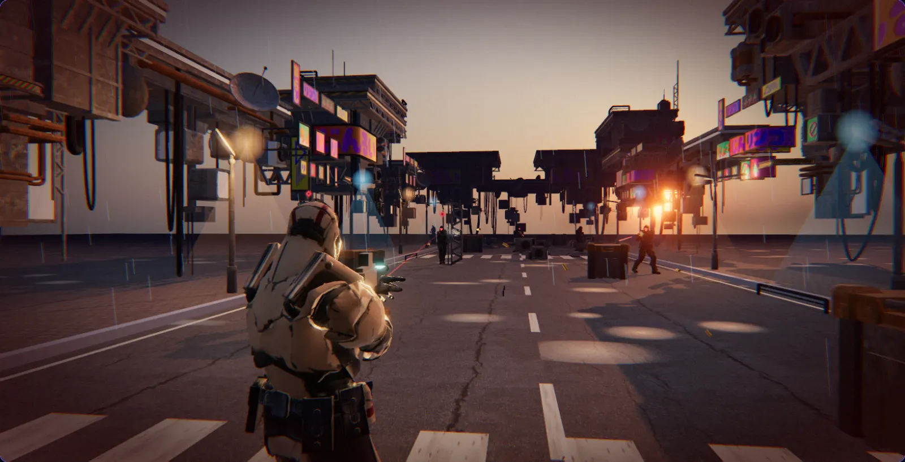
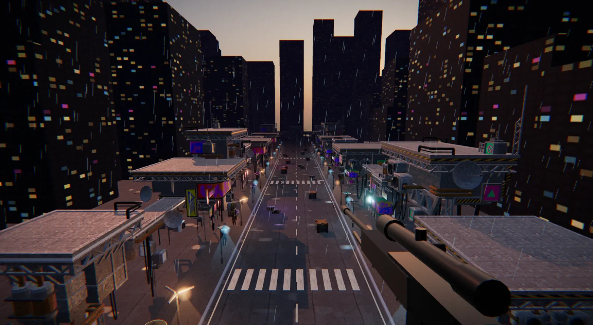
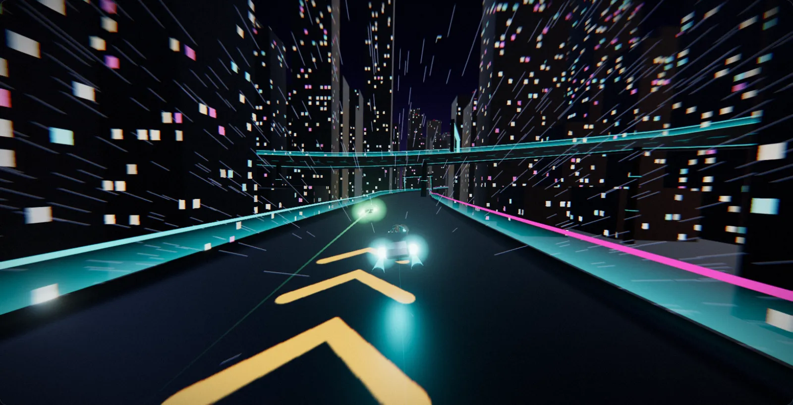
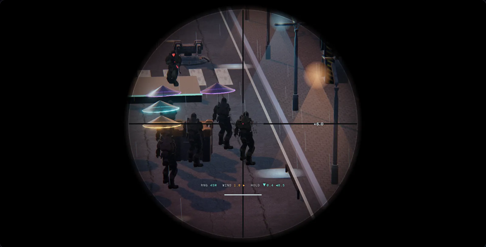

# Playverse

**Four browser games set in one neon megacity — District 07.** No install, no plugins: they run
in any modern browser on desktop and mobile, and the site installs as an app (PWA).

**▶ Play: https://playverse-rose.vercel.app**

| | Game | Genre |
| --- | --- | --- |
|  | **NEXUS 2100** | Squad tactical shooter: lead a four-operator squad through the city, with physics ragdolls and a global daily leaderboard. |
|  | **LONGSHOT** | Sniper: one rooftop nest, real bullet drop and wind, holdover reticle, bullet cam. |
|  | **VELOCITY** | Anti-grav racer: banked sky-lanes, drift-to-boost, five AI rivals, ghost of your best lap. |
|  | **ECHO** | Time-loop mystery: a 90-second loop ends in an assassination. Rewind, watch, find the shooter, one round per loop. |

## Tech

- **Next.js** (App Router) + TypeScript + Tailwind, deployed on Vercel
- **three.js** for rendering: PBR triplanar surfaces, HDR lighting, bloom and colour-grade post-processing, instanced cities
- **Rapier** (WASM) for physics and ragdolls
- **WebAudio**: every sound effect and the music are synthesised at runtime; there are no audio files
- **Upstash Redis** (optional) for the NEXUS leaderboard. Everything else lives in `localStorage`
- PWA: web manifest with per-game shortcuts, and a service worker that caches the static assets

## Run locally

```bash
npm install
npm run dev        # http://localhost:3000
npm run build && npm start
```

The NEXUS leaderboard needs `KV_REST_API_URL` and `KV_REST_API_TOKEN` (Upstash/Vercel KV). Without
them, development uses an in-memory board and production returns 503.

## Layout

```
src/
  app/                 # hub page, /games/[slug], /api/scores, manifest
  components/          # GameGrid, GameStage (client-only loader), icons
  lib/games.ts         # game registry: add an entry here to put a game on the hub
  games/
    nexus.ts      nexus-lib/      # shared: audio, physics, rig, surfaces, textures, HUD
    longshot.ts   longshot-lib/
    velocity.ts   velocity-lib/
    echo.ts       echo-lib/
public/assets/         # models, environment kit, HDRI, PBR textures (see ASSETS.md)
```

A game is a module that exports `createGame(container, hooks)` and returns an instance with `dispose()`.

## License

The code is under the [MIT](LICENSE) license. The 3D models, textures and HDRI in `public/assets/` keep
their own licenses (mostly CC0 by Quaternius and Poly Haven). See [ASSETS.md](public/assets/ASSETS.md).
